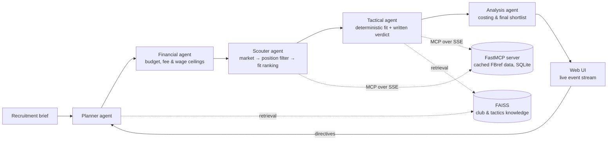

<div align="center">

# Scoutly AI

**A multi-agent recruitment analyst for football clubs: given a club, a budget and a need, who should it sign?**

Python · FastAPI · Azure OpenAI · Model Context Protocol (FastMCP) · FAISS · LangSmith · Docker · Fly.io

</div>

---

## What it does

A recruitment brief goes in: the club, the position, the playing style, the budget. A ranked shortlist comes
out, argued down from the whole market in front of you. A typical run starts from about 870 candidates and
ends with four, and every filter announces itself in the live event stream: the budget it sized, the
candidates it excluded and the number that excluded them, the tactical fit, and the cost of each signing on
the books.

It is built to say what it can't measure. When the data can't support a trait the club asked for, the player
card shows it as a qualitative gap instead of scoring it zero and pretending.

## How it works



- **Planner plus four specialists.** The planner turns the brief into a plan; the financial, scouter,
  tactical and analysis agents each own one step, and their work streams to the interface as it happens.
- **Human in the loop.** After the shortlist, the user can send directives to steer the run, ask questions
  about it, or finalise it.
- **Data through MCP.** Agents reach player data through an MCP server that answers from a prebuilt SQLite
  cache in about 0.1 s. Serving a request never scrapes.
- **Honest data.** Metrics the source serves empty are dropped, not stored as zeros, and each player's
  `trait_coverage` reflects what was actually measured.
- **Checked, not just run.** A benchmark harness runs real briefs across positions and leagues and
  validates each result against its constraints (budget sanity, eligibility, score consistency, data
  honesty), exiting non-zero for CI. A backtest asks whether, seeing only the 2024-25 season, it would have found the players clubs actually signed in summer 2025.
- **Observable and deployable.** LangSmith tracing, a health check that verifies the model deployment and
  the data cache, and a single-container deploy to Fly.io.

---

## Running it

1. Copy `.env.example` to `.env` and fill in your Azure OpenAI, embedding and Tavily keys.
2. Build the player database **once** (see below).
3. Build the RAG vector store once: `python -m backend.rag.loader`
4. Run: `.\start_local.ps1`

## The player database is populated once, offline

Serving a scouting request never scrapes. All FBref/Capology traffic happens in a
single offline build that writes `data/fbref_cache.db`; the MCP server then answers
every query from SQLite in ~0.1 s and never launches Chrome.

```bash
python -m backend.data_pipeline.cache_builder
```

Useful flags:

| Flag | Effect |
| --- | --- |
| `--verify` | Report per-metric coverage and exit. Exit code 1 if anything is incomplete. |
| `--no-wages` | Skip the Capology pass (it is slow and often blocked). |
| `--fresh` | Discard staged tables and re-scrape everything. |
| `--enrich-only` | Refresh metrics for players already cached, without changing the roster. |
| `--legacy-db PATH` | Backfill metrics FBref will not serve from an older cache. |

A cold build takes 10–15 minutes: each Big-5 combined table needs ~2 minutes and
there are six of them. Every table that succeeds is checkpointed to
`data/_build_stage/`, so a Chrome crash mid-build resumes rather than starting over.

Check what you have at any time:

```bash
python -m backend.data_pipeline.cache_builder --verify
```

### Known data limitation

FBref currently serves five columns entirely empty to this scraper — `Tkl`, `Cmp%`,
`Att Pen`, `SCA` and `GCA` — while `TklW`, `Int`, `Gls`, `Ast`, `Sh` and `SoT` come
through fine. This reproduces across separate scrapes, so it is not throttling.

The builder detects all-zero columns and **drops** them rather than storing fake
zeros. Traits that depend on them become explicit qualitative gaps for the tactical
agent to judge, and `trait_coverage` reflects reality. Storing them as 0.0 would make
every player score identically on that metric while reporting full coverage.

To fill them, point `--legacy-db` at a cache built from another source.

## Runtime data policy

| Env var | Default | Effect |
| --- | --- | --- |
| `FBREF_LIVE_SCRAPE` | `false` | Allow tools to hit FBref when the cache misses. Leave off. |
| `FBREF_USE_MOCK` | `false` | Skip ScraperFC entirely, even in the builder. |

## Benchmarking the pipeline

`benchmark_pipeline.py` runs the real agent pipeline over several briefs — one per
position, across leagues — and validates each result against the constraints it
was given, rather than just checking that it produced output.

```bash
python benchmark_pipeline.py
```

| Flag | Effect |
| --- | --- |
| `--only 1,3` | Run selected briefs by id |
| `--gap 45` | Seconds between runs, to respect provider rate limits |

Each run is checked for budget sanity (weekly wage vs fee on the right scales, no
inverted range, no candidate silently over the ceiling), eligibility (nobody
already at the buying club, primary position matches the brief), scoring
consistency (`demonstrated_fit <= measurable_fit`, shortlist actually ordered by
it, contiguous ranks), and data honesty (wages not all identical, no metric
present with a null value). Output lands in `benchmarks/<timestamp>/` with
per-run JSON, the reports, and a summary table.

Exit code is non-zero if any run failed or any check failed, so it works in CI.

## Health check

`GET /api/health` reports whether the two hard dependencies are actually usable —
the Azure OpenAI deployment resolves, and the player cache is populated. Both
otherwise fail deep inside a pipeline run.
